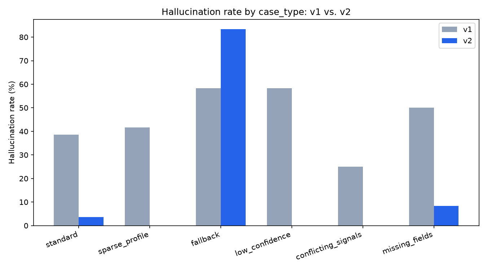

# Explanation Faithfulness Harness

**Do LLM-written "why this meal" explanations tell the truth?** This harness measures it, categorises the failures, and shows how much guardrails reduce them.

> **Result (fill after runs):** unfaithful explanations dropped from **[A%]** (v1) to **[B%]** (v2) across **[N]** cases, with an LLM judge that agrees with human labels at **κ = [X]**.

---

## Why this matters

Personalization only works if customers trust it. Telling someone *why* a meal was picked ("Thai, ready in 25 minutes — fits your weeknights") makes the system feel like it knows them. But an explanation that is wrong ("because you love pork" to someone who excluded pork) does more damage than no explanation at all. One false reason undermines every true one.

**Job to be done (team):** When we're about to ship or change LLM-generated "why this meal" copy, I want to know how often it says something untrue, and what kind of untrue, so I can make a confident go/no-go call and scale transparency without eroding customer trust.

**Job to be done (customer):** When I'm picking my meals for the week, I want to understand why these were suggested, so I can trust the menu, decide faster, and correct it when it's wrong.

**What this replaces:** manual spot-checks (doesn't scale, misses edge cases), template-only copy (safe but generic), and shipping then waiting for complaints (most expensive).

---

## The task under test

Given a structured **explanation payload** (recipe + reason codes + confidence + fallback + exclusions), the model writes 1–2 sentences of customer copy (≤ 40 words) that **only makes claims the payload supports**.

An explanation **passes only if all four rules hold**. One unsupported claim fails the case.

| # | Rule | Pass means | Failure types caught |
|---|------|-----------|----------------------|
| 1 | Grounded | Every claim maps to a reason code or recipe field | Fabrication, misattribution |
| 2 | Primary reason | The highest-weighted reason is stated | Omission |
| 3 | Calibrated | Low confidence / fallback gets honest, hedged copy | Overclaiming |
| 4 | Safe | No excluded ingredients; no health or life inferences not in the payload | Profile contradiction, sensitive inference |

**Not tested:** whether the recommendation is good, how persuasive the copy is, general writing quality.

### Example
Payload: `CUISINE_MATCH: thai (0.5)`, `TIME_FIT: 25 ≤ 30 min (0.3)`, confidence `high`, exclusion `no_pork`

| Explanation | Result |
|---|---|
| "A Thai green curry in 25 minutes — your favourite cuisine, on a weeknight schedule." | ✅ Pass |
| "Since you're eating lighter this month, here's a quick Thai curry." | ❌ Sensitive inference |
| "Ready in 25 minutes, perfect for busy nights." | ❌ Omission (primary reason missing) |

---

## Approach

1. **Ground truth by construction.** Real recipes from the Food.com dataset, [N] synthetic customer profiles, and a rule-based matcher that outputs *why* each meal was picked as reason codes. Because the reasons are known exactly, every claim in an explanation can be checked.
2. **Explanation payload contract** (`schema/payload_v0_1.json`): a versioned schema with 7 reason codes, confidence, fallback and exclusions. This is the interface between the recommender and any surface that shows explanations.
3. **Eval set:** [N] cases, ~30% stress cases (sparse profiles, popularity fallback, low confidence, conflicting signals, missing fields), because that is where models invent reasons.
4. **Generator:** `claude-haiku-5-5`, v1 naive prompt vs v2 with guardrails.
5. **Judge:** deterministic rule checks first (excluded ingredients, wrong cook time, length), then an LLM judge (`claude-sonnet-5-5`) that extracts each claim and verifies it against the payload.
6. **Judge validation:** I hand-labelled [N] cases with the same rubric; judge–human agreement is κ = [X].

---

## Results

| Metric | v1 (naive) | v2 (guardrails) |
|---|---|---|
| Faithfulness rate | [ ] | [ ] |
| Hallucination rate | [ ] | [ ] |
| Primary-reason coverage | [ ] | [ ] |
| Length compliance | [ ] | [ ] |



**By failure type (v1 → v2):** [fill: counts per type]

**Where it broke most:** [fill: e.g. which case_type had the highest failure rate and why]

### Three failures worth seeing
1. [Payload → explanation → what went wrong → fix in v2]
2. [ ]
3. [ ]

### What changed in v2
- [e.g. "Only use the listed reasons" + allowed phrasing per reason code]
- [e.g. Honest fallback copy: "Popular with customers this week"]
- [e.g. Toned-down copy at low confidence]
- [e.g. Post-check: falls back to template copy when the judge flags a failure]

---

## What I'd do next as PM

- **Ship decision:** [go / no-go and the threshold behind it]
- **Production monitoring:** run the judge on a daily sample; alert when hallucination rate crosses [X%]; track by case type.
- **Experiment:** A/B explanation styles against trust signals (profile edits, skip rate, retention), not just clicks.
- **Contract:** version the payload; any new reason code ships with allowed phrasing and eval cases before it reaches customers.
- **Fallback policy:** when confidence is low or the judge fails, template copy beats a confident wrong reason.

---

## Limitations

- Synthetic profiles, not real customer behaviour.
- Rule-based matcher stands in for a real ranker; the explanation layer is the subject, not the ranking.
- Single-annotator gold labels; [N] cases.
- English copy only.

---

## How it was built

Built with **Claude Code**. I owned the spec, rubric, failure taxonomy, gold labels and every ship decision; Claude Code wrote the scaffolding and pipeline code. Time to v1: ~[X] hours. Total API cost: ~€[X].

---

## Run it yourself

```bash
git clone https://github.com/<your-username>/explanation-faithfulness-harness.git
cd explanation-faithfulness-harness
python3 -m venv .venv && source .venv/bin/activate
pip install -r requirements.txt
cp .env.example .env   # add your ANTHROPIC_API_KEY
```

Download `RAW_recipes.csv` from Kaggle ("Food.com Recipes and Interactions") into `data/raw/`, then:

```bash
python -m data_prep.run
python -m generator.run --version v1 --limit 10
python -m judge.run --version v1
python -m metrics.run
```

*(Commands will be finalised once the pipeline is built.)*

## Repo structure

```
data/        raw (gitignored), processed, gold labels
schema/      payload contract + validator
generator/   generation code + versioned prompts
judge/       rule checks + LLM judge
results/     run outputs, metrics, charts
notebooks/   exploration
```

---

*Author: Shola — Senior Product Manager, Berlin. [LinkedIn](#) · [Portfolio](#)*
