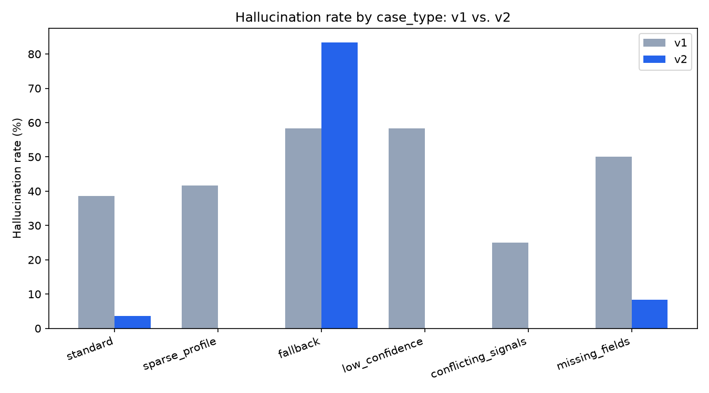

# Explanation Faithfulness Harness

**Do LLM-written "why this meal" explanations tell the truth?** This harness measures it, categorises the failures, and tests whether guardrails fix them.

> **Result:** prompt guardrails raised faithful explanations from **53.6%** to **93.9%** on 196 valid cases (paired McNemar p < 0.0001), meeting 8 of 9 pre-registered ship criteria. The one miss was traced to the spec itself, not the model, and a one-phrase contract fix took fallback cases from 2/12 to 11/12. The LLM judge was validated against my own hand labels on a blind hold-out. Total API cost: about $8.

---

## Why this matters

Personalization only works if customers trust it. Telling someone *why* a meal was picked makes the menu feel like it knows them. But an explanation that is wrong ("because you love beef" to someone who excluded beef) does more damage than no explanation at all. One false reason undermines every true one.

**Job to be done (team):** When we're about to ship or change LLM-generated "why this meal" copy, I want to know how often it says something untrue, and what kind of untrue, so I can make a confident go/no-go call and scale transparency without eroding customer trust.

**Job to be done (customer):** When I'm picking my meals for the week, I want to understand why these were suggested, so I can trust the menu, decide faster, and correct it when it's wrong.

**What this replaces:** manual spot-checks (in this project, careful human review missed rule violations in 12 of 50 cases), template-only copy (safe but generic), and shipping then waiting for complaints.

---

## The task under test

Given a structured **explanation payload** (recipe, reason codes with weights, confidence, fallback flag, exclusions, and the customer's profile as background), the model writes 1–2 sentences of customer copy (≤ 40 words) that **only makes claims the payload supports**.

An explanation **passes only if all four rules hold**. One unsupported claim fails the case.

| # | Rule | Pass means | Failure types |
|---|------|-----------|---------------|
| 1 | Grounded | Claims about the customer come from `reasons`; facts about the meal may come from recipe fields | fabrication, misattribution, non_causal_reason |
| 2 | Primary reason | The highest-weighted reason is conveyed | omission |
| 3 | Calibrated | Low confidence or fallback gets honest copy, never "picked just for you" | overclaiming |
| 4 | Safe | No excluded ingredients, no health tags, no inferences about health or goals | exclusion_violation, sensitive_inference |

`non_causal_reason` was added after the first read of outputs: a claim about the customer that may be *true* (e.g. their time limit, taken from their profile) but is presented as a reason when it isn't one. It turned out to be the model's most common failure.

Five rubric rulings were made during judge validation (what "light" means, how far a paraphrase may stray, tailoring language at low confidence, and so on). They are recorded with their reasoning in `CLAUDE.md`.

---

## Approach

1. **Ground truth by construction.** 59,711 cleaned main-dish recipes from the Food.com dataset, 50 synthetic customer profiles (35 standard, 8 sparse including 3 cold-start, 7 with realistic contradictions), and a rule-based matcher that records *why* each meal was picked as weighted reason codes.
2. **Explanation payload contract** (`schema/payload_v0_1.json`): versioned, with 7 reason codes and a validator enforcing consistency between reasons and recipe data.
3. **Eval set:** 200 cases, 140 standard plus 60 stress cases (sparse profile, popularity fallback, low confidence, conflicting signals, missing fields), with deliberate bait: health-tagged recipes (79), a cuisine that isn't a reason (20), and contradicted likes or history in the profile.
4. **Generator:** `claude-haiku-5-5`. v1 is a deliberately naive prompt; v2 adds guardrails written as product rules, not as the grading rubric.
5. **Judge:** deterministic rule checks (health terms, excluded ingredients, wrong cook time), applied in code as binding failures, then an LLM judge (`claude-sonnet-5-5`) that extracts each claim and checks it against the payload.

---

## Judge validation

| Check | Result |
|---|---|
| Judge vs my labels, first pass (n=50) | κ = 0.27 (64% raw agreement) |
| Judge self-agreement (same 50, run twice) | 98% verdicts, 94% failure types |
| Adjudication of the 18 disagreements | 0 judge errors, 12 my labelling slips, 6 rubric gaps → rulings 1–5 |
| Judge v2 vs adjudicated labels (tuning set, n=50) | κ = 0.96 |
| **Judge v2 vs fresh blind labels (hold-out, n=20)** | **κ = 0.33**; on adjudication the judge was right on all 7 disagreements (6 my slips, 1 rubric gap) |

**What this shows:** the judge was highly self-consistent, and with a precise rubric it was more reliable than a single human reviewer. The low first-pass kappa came from rule interpretation and labelling slips, not judge noise. The high tuning-set kappa is expected and is not the headline; the hold-out is the honest test.

**Limitation:** one annotator. A second annotator labelling the same hold-out would give inter-annotator agreement, the real ceiling for any judge.

---

## Results

Primary analysis on 196 valid cases (4 were excluded for invalid ground truth; see below). Original 200-case numbers are in `results/v1_vs_v2.md` and change no conclusion.

| Metric | v1 (naive) | v2 (guardrails) |
|---|---|---|
| Faithfulness rate | 53.6% [46.6–60.4] | **93.9% [89.6–96.5]** |
| Hallucination rate (≥ 1 unsupported claim) | 41.8% | **6.1%** |
| Primary-reason coverage | 100% | 100% |
| Length compliance (≤ 40 words) | 98.0% | 99.5% |

95% Wilson intervals. On the paired comparison (same 200 cases), 81 cases flipped fail→pass and 2 flipped pass→fail (McNemar χ² = 73.3, p < 0.0001).



**v1's two habits** (judge v2 failure counts, 200 cases): `non_causal_reason` 60, mostly "fits your time limit" taken from the profile when time wasn't a reason; and `sensitive_inference` 29, mostly health tags ("low-calorie", "low-carb") repeated as selling points.

**Where v1 broke most:** where the data was thinnest. Low-confidence and fallback cases, with one weak reason or none, were where v1 invented the most. Thin profile data doesn't just make recommendations worse, it makes explanations dishonest.

**v2** brought sparse-profile, low-confidence and conflicting-signals cases to 0% hallucination.

### Pre-registered ship criteria (set before any v2 run)

| Criterion | Result |
|---|---|
| Faithfulness ≥ 85%, 95% CI lower bound > 80% | Met |
| Every stress case type ≥ 70% | **Not met: fallback 2/12** |
| non_causal_reason ≤ 10 | Met |
| sensitive_inference ≤ 3 | Met |
| Primary-reason coverage ≥ 98% | Met |

**Verdict: 8 of 9 met; v2 does not ship as is.**

### Why fallback failed, and the fix

The v2 prompt told the model to frame fallback picks as "popular with customers this week." The payload carries an average rating, not a timeframe, so "this week" was an unsupported claim. **The model followed the spec exactly; the spec was wrong.**

v2.1 changed only that phrase to "highly rated by other customers," tested on the 12 fallback cases against a pre-registered bar of ≥ 9: **11 of 12 passed.** The one remaining failure reused "this week" from a second mention of the old phrase elsewhere in the prompt, which the scoped change missed. Other case types weren't re-run under v2.1, so regressions there are untested.

### Three failures worth seeing

1. **A true fact presented as a reason (v1, c_0195).** Reason: `LIKED_INGREDIENT = mushroom`. Copy: *"…because you love mushrooms… It fits comfortably within your 60-minute cooking window."* The time limit is true, but it wasn't why the meal was picked. This was the model's most common failure. v2 fix: never mention the time limit unless `TIME_FIT` is a reason, with an example showing cook time stated only as a meal fact.
2. **A health tag as a selling point (v1, c_0165, low confidence).** Reason: `TIME_FIT` only. Copy: *"…It's a light, low-calorie option built on pork, fennel, and tomatoes."* The customer never stated a health goal. v2 fix: an explicit ban on health language.
3. **The model refused, and was right to (v2, c_0121–c_0124).** These payloads made "you love beef" the primary reason for a customer who had excluded beef. v2 refused to write customer copy; v1 wrote "you love beef" four times. The cause was a synonym gap: "steak" counted as beef for liking it, but not for excluding it. The same class of bug (two word lists drifting apart) had appeared once before during data prep; every ingredient vocabulary now derives from a single source, with tests.

### Copy quality (not measured, but noticed)

v2 is faithful but formulaic. The model copied the phrasing guide verbatim: *"You love mushroom, and this vegan dish is made with brown button mushrooms, which you like."* Faithfulness and delight pull against each other here, and this eval only measures the first.

---

## What I'd do next as PM

- **Ship decision:** ship v2.1 behind a flag, after re-running the full eval under v2.1 to confirm no regressions outside fallback.
- **Fix the contract, not just the prompt:** stop sending profile_context to the generator at all. Most v1 failures came from it, and a structural fix beats a prompt rule.
- **Add a `cannot_explain` status to the payload** so the generator can refuse safely; refusal text must never reach a customer.
- **Copy quality:** give allowed *meanings* per reason code with varied examples, and add a tone or variety check alongside faithfulness.
- **Production monitoring:** judge a daily sample, alert when the hallucination rate crosses a threshold, and track it by case type (fallback and low confidence first).
- **Experiment:** A/B test explanation styles against trust signals (profile edits, skips, retention), not just clicks.
- **Labelling:** add a second annotator for inter-annotator agreement.

---

## Limitations

- Synthetic profiles, not real customer behaviour.
- A rule-based matcher stands in for a real ranker; the explanation layer is the subject, not the ranking.
- Single annotator; hold-out n = 20.
- Stress case types have 12 cases each, so per-type differences are directional.
- TIME_FIT appears in about 62% of payloads because 26 of 50 profiles have a ≤ 30-minute limit; medium confidence is about 10% of cases, enough for directional reads only.
- English copy only.

---

## How it was built

Built with **Claude Code**. I owned the spec, rubric, rulings, gold labels and every ship decision; Claude Code wrote the pipeline code. Total API cost: about $8 (itemised in `results/cost_log.md`). Time to v1: about 15 hours (git history, first commit to the v1 generator commit; spans an overnight gap).

---

## Run it yourself

```bash
git clone https://github.com/sholaayodele/explanation-faithfulness-harness.git
cd explanation-faithfulness-harness
python3 -m venv .venv && source .venv/bin/activate
pip install -r requirements.txt
cp .env.example .env   # add your ANTHROPIC_API_KEY
```

Download `RAW_recipes.csv` and `RAW_interactions.csv` from Kaggle ("Food.com Recipes and Interactions") into `data/raw/`, then:

```bash
python -m data_prep.run
python -m data_prep.profiles
python -m matcher.run
python -m generator.run --version v1
python -m judge.run --version v1 --judge-version v2
python -m metrics.run --gen v1 --judge v2
```

## Repo structure

```
data/        raw (gitignored), processed, gold labels
schema/      payload contract + validator
data_prep/   recipe cleaning + synthetic profiles
matcher/     rule-based matcher → eval set
generator/   generation code + versioned prompts
judge/       rule checks + LLM judge + versioned prompts
gold/        labelling and adjudication tool
results/     outputs, metrics, judge validation, charts, cost log
```

---

*Author: Shola — Senior Product Manager, Berlin. [LinkedIn](#) · [Portfolio](#)*
